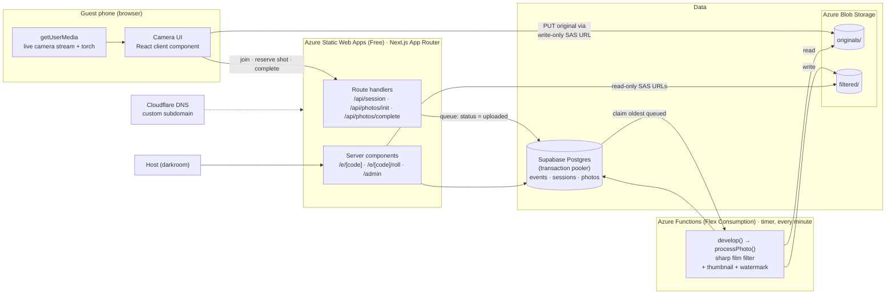
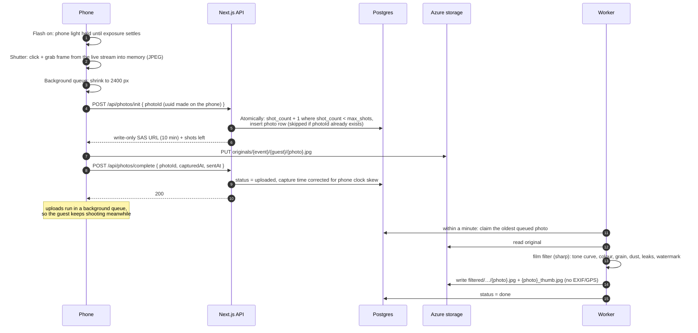

# blindshot

*a disposable camera for your party*

Guests scan a QR code at an event and get a 13-shot roll of film on their phone, with a viewfinder exactly one inch wide. There are no previews: you wind the film, press the shutter, and never see the frame. Every photo is stored untouched, and a copy is developed with a lomography look, the cheap-camera colour that early Instagram filters imitated, tuned against real disposable-camera scans. After the party the whole roll develops at once, and every guest sees everyone's photos on one shared roll.

It started as a tool for a first event in Seattle in November 2026 and is being built so any event can run it with its own theme.

---

## Why

**Phones pull people out of the party.** People spend the night looking at screens: framing, checking, retaking, filtering. A disposable camera works the other way. You get a few shots, you can't see them, so you take the photo and get back to the room.

- **Scarcity makes each shot count.** 13 frames means choosing the moment instead of firing off a burst.
- **No preview keeps people present.** There's nothing to check, so the phone goes back in the pocket.
- **The shared roll is the payoff.** Days later, everyone's frames develop together into one collective record of the night, seen from 200 angles instead of one.
- **Hosts get every photo in one place.** No chasing pictures across group chats and AirDrops, and consent and opt-outs are recorded per guest.

The longer-term aim is a product hosts can buy per event: one camera, with a **theme overlay** for each event (colours, decor, fonts, copy). The first theme is a desi-retro Diwali look.

---

## The experience

| Moment | What the guest sees |
|---|---|
| **Scan** | A QR code at the venue opens `/e/{event}` in the phone's browser. No app, no account. |
| **Load film** | First name, an optional Instagram handle (so the host can tag you; shown in the darkroom), one consent tick, and two optional opt-outs (no promotional use; keep my photos out of the shared roll). |
| **Shoot** | A camera body on screen: 1-inch live viewfinder, a thumbwheel you drag to wind on, a flash switch, a mechanical shot counter. Shutter → click, flash, vibration, "Saved". Never the photo. |
| **Wrap** | After 13 shots: "That's a wrap", and when the roll develops. On events with new rolls on (`--new-rolls`), a **Load a new roll** button gives the same guest a fresh roll, no rejoining. |
| **Develop** | At the release time, the shared roll opens: everyone's frames, host picks, your own. Any frame can be saved to the phone's camera roll. |

The host gets a **darkroom** (`/admin`): every frame as it arrives, star and hide, the untouched originals, guests' opt-outs, the QR code to print, and the switch that releases the roll.

---

## Architecture



**The website never touches an image.** Phones upload straight to Azure with a short-lived URL that can write exactly one file and read nothing. The website only issues those URLs and records metadata, which is cheap enough for a whole party pressing the shutter at once.

**Filtering runs on a separate worker.** An Azure Function wakes every minute and develops the queue, oldest first, one photo at a time. The queue is just the `photos` table: rows with `status = 'uploaded'`, claimed with `for update skip locked`, so a second worker (or a test) can run alongside safely. This split is the result of a load test: when 100 uploads ran the filter on the website's own free backend, every request timed out and the site stayed down until redeployed. With the worker, 100 simultaneous shots all upload within 18 s and are developed about 4 minutes later. At event scale, 200 guests firing three bursts (600 photos) all upload within 41 s each, and the worker develops about 30 a minute, three at a time. A 200-guest night averages about 11 a minute (`npm run load`).

### Lifecycle of one shot



If the signal drops, the phone keeps retrying the same `photoId`. Because the id is made on the phone, a retry gets a fresh upload URL for the same frame instead of spending another shot.

---

## Stack

| Layer | Choice | Why |
|---|---|---|
| App | **Next.js 16** (App Router, TypeScript) | One codebase for the guest UI, API routes and the darkroom. Built as a self-contained `standalone` server (~60 MB). |
| Hosting | **Azure Static Web Apps** (Free plan, hybrid Next.js) | $0. Server-rendered pages and API routes run on a managed backend. Push to `main` deploys; pull requests get preview URLs, which double as HTTPS phone test builds (the camera needs HTTPS). Custom subdomain through a Cloudflare `CNAME`. |
| Database | **Supabase Postgres** via `postgres.js` | Plain SQL. The shot limit is one atomic statement, so two fast taps can't overrun it. Connected through the transaction pooler: the direct `db.*.supabase.co` host is IPv6-only, and Azure's backend can't reach it. |
| Photo storage | **Azure Blob Storage** (StorageV2, LRS) | Cheap bulk storage (a few GB a party); SAS URLs give phones scoped, expiring upload rights. |
| Image processing | **sharp** (libvips) on **Azure Functions** (Flex Consumption, Node 24) | Native processing in Node, about 1 to 2.5 s per photo end to end. Runs in the worker, never on the website. Every photo also gets a 640 px thumbnail, so grids load ~60 KB per frame instead of ~700 KB. Pay-per-use: a party's worth of photos fits in the free monthly grant. |
| Camera | **getUserMedia** + canvas | Live 1-inch viewfinder; frames stay in memory, so nothing lands in the camera roll. The phone light acts as the flash where the browser exposes it. |
| Styling | Plain CSS with design tokens | Each event theme is a token set; no UI framework to fight. |

---

## Design decisions

**Nothing is stored on the guest's phone.** Shots are taken from the camera stream in memory and uploaded. The trade-off is that a shot still uploading is lost if the page closes, so the page warns before closing.

**The flash is the phone light, timed by the picture.** Browsers can only turn the phone light on or off. With the flash on, the light comes on first and stays on until frame brightness stops changing (auto-exposure has caught up, 0.7 to 2 s), then the click, screen flash and capture happen together. The phone's real strobe through `ImageCapture.takePhoto({ fillLightMode: "flash" })` was tried and dropped: on Android it often didn't fire, and its pre-flash landed after the click. Browsers that don't expose the light (Firefox, some iOS versions) get the screen flash only.

**The camera never gets stuck.** If the viewfinder hasn't opened after 8 seconds (another tab holding the camera, a lost permission prompt), the app falls back to the phone's own camera app through a file input, and switches to live if the stream turns up later.

**Small uploads for party Wi-Fi.** Photos are shrunk on the phone to 2400 px (the filter outputs 2000 px) in the background upload queue, so the shutter never waits on it.

**Capture times line up across phones.** Each upload carries the phone's clock at send time, and the server shifts the capture time by the difference from its own clock. Shots several guests take together then land within a fraction of a second of each other, which is what crowdsourced wigglegrams (several angles of one moment, looped) need.

**The film look is one fixed recipe, not AI.** Early versions used a depth-estimation model to put the flash on whatever was closest to the camera. It looked staged, so it was removed: every photo now goes through the same tone curve, colour grade, grain and defects, tuned against real disposable scans. That also took out a 291 MB dependency that wouldn't fit in a serverless function.

**Originals are sacred.** The file the phone sends is stored as is. The filtered copy is derived from it and carries no EXIF or GPS, and the darkroom always links back to the original.

**No accounts.** Joining sets an httpOnly cookie with a random token, and only its hash is stored. The host logs in with one password; the cookie holds an HMAC of it, never the password itself.

**Consent is explicit and stored per guest.** Every guest agrees to the sharing terms when they join. When an event allows it, guests can also keep their photos off the shared roll or out of promotion, and the darkroom flags those frames.

**Themes are data.** A theme is a CSS token set plus a few decor switches (garland, diya flash light, band text). A new event's look needs no new components.

---

## The film filter

`applyFilmFilter(buffer, options) → buffer` in [`lib/film.ts`](lib/film.ts) is a pure function with tunable options:

1. Decode (HEIC included, decoder loaded only when needed), fix orientation, resize to a 2000 px scan
2. Tone: S-curve with a lifted, olive-tinted black point and highlights allowed to blow out
3. Colour: richer saturation, slight warmth, olive-green shadows
4. Halation glow around bright lights
5. Clumped grain, stronger in the shadows
6. Plastic-lens vignette, slight softness
7. Defects drawn as SVG layers: dust, curly fibres, the odd scratch, light leaks on about 25% of frames (most likely on the first and last frame, as on a real roll), optional LED date stamp (bottom-left, off by default)
8. Credit watermark, bottom-right, set in Special Elite and pre-traced to SVG paths (no fonts needed on the server). Its tone flips light or dark from the brightness behind it, with an opposite-tone halo, so it stays readable on any frame.

**Panned long exposure.** About 1 frame in 10 smears sideways as if the camera swept during a long exposure, by 4-9% of the width, a little brighter for the extra light. The smear is light in the middle of the frame and full toward the edges, so the subject (nearly always near the middle) stays readable while the room streaks past. It never stacks with the dragged shutter.

**Dragged shutter.** About 1 frame in 8 gets the party-disposable slow-shutter look: the frame stays sharp, as if frozen by the flash, with a ghost of the scene shaken along a short curved path blended over it.

**Overlays (optional, per event).** Events created with `--overlays` get images from two licensed packs screened over some frames, instead of the drawn leak: a film artifact on about 1 frame in 12, or a softer film burn on about 1 in 10, never both. Each use is zoomed into a different part, mirrored, tilted and faded, so no two frames match. The packs can't be redistributed, so the images are never committed: `npm run overlays -- artifacts "<pack folder>" 08 17` (or `burns … 01 15 47 58`) copies your picks into the gitignored `overlays/<kind>/`, and `scripts/deploy-worker.sh` ships them inside the worker only. Check each pack's license before a commercial event: the burns pack allows commercial use, the artifacts pack is personal use only.

A local film lab (`npm run lab`) runs it over a folder of photos so the look can be tuned without running the app. `npm run watermark -- --font Font.ttf --text "@handle"` regenerates the watermark.

---

## Testing

`npm test` runs Playwright end-to-end tests on emulated mobile Chrome, Samsung Internet (Chromium engine), Safari (WebKit) and Firefox with a fake camera, plus API and filter tests. `BASE_URL=https://… npm test` runs the same suite against a deployment. Locally the tests develop the queue themselves; against a deployment they wait for the real worker.

`npm run load` is the party-rush test: 100 guests join a throwaway event and press the shutter at the same moment (`npm run load -- 200 2` for 200 guests, 2 shots each). It reports each stage's latency and how long the worker took to develop everything, then deletes the event.

What emulators can't cover (the real phone light, real camera hardware, the iOS permission UI) is checked by hand on real phones.

User stories and their test coverage: [docs/user-stories.md](docs/user-stories.md).

---

## Project lifecycle

| Phase | Status | What it covers |
|---|---|---|
| **0 · Film lab** | ✅ Done | Filter as a pure function, local lab script, tuned against real disposable scans over several rounds. |
| **1 · Interactive mocks** | ✅ Done | Clickable prototype of the guest flow; desi-retro event theme alongside the base look; community roll. |
| **2 · MVP** | ✅ Done | Camera, direct-to-storage uploads, server-enforced roll limit, filtering, shared roll, darkroom, event themes. Tested end to end against local emulators. |
| **3 · Deploy and demo** | ✅ Live | Supabase + Azure Static Web Apps + Azure storage + Azure Functions worker on a custom subdomain. Load-tested at 100 simultaneous shots. Real-phone testing and flash tuning under way; demo to the event partner next. |
| **4 · First live event** | 📅 Nov 2026 | ~200 guests, ~2,600 photos. Watch upload success rate, processing time, drop-offs at the camera permission prompt. |
| **5 · Hardening** | Planned | Emailed 4-digit codes to find your roll on any device, upload retry that survives closing the page, rate limiting. |
| **6 · Product** | Planned | Host sign-up and self-serve events, theme builder, per-event pricing, bulk download for hosts, wigglegram builder from shots taken together. |

---

## Repo layout

```
app/
  e/[code]/            guest camera (CameraApp.tsx) and shared roll (roll/)
  admin/               the darkroom: page, server actions, login
  api/session          join an event
  api/photos/init      reserve a frame, issue upload URL
  api/photos/complete  record metadata, queue the photo for the worker
lib/
  film.ts              the film filter (pure function)
  watermark.ts         pre-traced watermark paths (generated)
  process.ts           original → filtered pipeline, and the queue (develop)
  storage.ts           Azure SAS URLs, upload, download
  db.ts  session.ts    Postgres, guest + host sessions
  themes.ts            event themes
worker/                Azure Functions entry: develop the queue every minute
scripts/               setup, event creation and reset, worker, load test, film lab, watermark
supabase/schema.sql    tables
docs/                  user stories
```

---

## Running it

You need **Supabase** (database, free tier) and **Azure** (photo storage + Static Web Apps hosting on the Free plan).

1. **Supabase:** create a project. Click **Connect** in the top bar → *Connection String* → **Transaction pooler** (port 6543). Not the direct `db.*.supabase.co` string: it's IPv6-only and Azure can't reach it.
2. **Azure:** create a storage account (StorageV2, Standard LRS). Copy the account name and a key from *Security + networking → Access keys*.
3. **Env:** `cp .env.example .env.local` and fill it in.
4. **Create tables, containers and storage CORS** (safe to re-run; keeps any CORS rules already on the account):
   ```bash
   npm install
   npm run setup
   ```
5. **Create an event:**
   ```bash
   npm run event -- --code diwali --name "Diwali Night" --subtitle "Nov 7 · Seattle" \
     --theme diwali --release 2026-11-09T18:00:00-08:00
   ```
   Leave out `--release` to hold the roll until you release it from `/admin`. Other flags: `--shots 11`, `--no-opt-outs`, `--date-stamp`.
   To start a roll over (deletes every photo and guest; the link stays): `npm run reset -- diwali`, optionally with `--shots 6`.
6. **Run it:** `npm run dev` and, in a second terminal, `npm run worker` (it develops the photos). Then open `http://localhost:3000/e/diwali` and `http://localhost:3000/admin`.

### Deploy to Azure Static Web Apps (Free)

Deploys run from [`.github/workflows/deploy.yml`](.github/workflows/deploy.yml): push to `main` → production, pull request → its own preview URL.

1. Create the app (Free plan, no source link; the workflow does the deploying):
   ```bash
   az staticwebapp create -n blindshot -g <resource-group> -l westus2 --sku Free
   ```
2. Give GitHub the deploy token:
   ```bash
   az staticwebapp secrets list -n blindshot --query properties.apiKey -o tsv \
     | gh secret set AZURE_STATIC_WEB_APPS_API_TOKEN
   ```
3. Set the runtime env vars from `.env.example` (`SITE_URL` = your domain):
   ```bash
   az staticwebapp appsettings set -n blindshot --setting-names DATABASE_URL=... AZURE_STORAGE_ACCOUNT=... AZURE_STORAGE_KEY=... ADMIN_PASSWORD=... SITE_URL=https://blindshot.example.com
   ```
4. **Custom domain on Cloudflare:** add a `CNAME` from the subdomain to the app's `*.azurestaticapps.net` hostname, **DNS only (grey cloud)**, then `az staticwebapp hostname set -n blindshot --hostname blindshot.example.com`. Azure validates it and issues the HTTPS certificate. Once that's done you can turn the Cloudflare proxy back on if you want it.
5. Run `npm run setup` locally with the same `SITE_URL`, so storage CORS accepts uploads from the domain.
6. Push to `main`, then open `/admin` and print the QR code.

### Deploy the worker to Azure Functions

The website doesn't filter photos; this worker does. Flex Consumption is pay-per-use, so an idle worker costs next to nothing.

1. Create the app next to the storage account (it also creates an Application Insights resource for its logs):
   ```bash
   az functionapp create -g <resource-group> -n blindshot-worker --flexconsumption-location westus2 \
     --runtime node --runtime-version 24 --storage-account <storage-account> --instance-memory 2048
   ```
2. Give it the same `DATABASE_URL`, `AZURE_STORAGE_ACCOUNT` and `AZURE_STORAGE_KEY`:
   ```bash
   az functionapp config appsettings set -g <resource-group> -n blindshot-worker --settings DATABASE_URL=... AZURE_STORAGE_ACCOUNT=... AZURE_STORAGE_KEY=...
   ```
3. Deploy (needs Azure Functions Core Tools, `func`): `scripts/deploy-worker.sh`. Re-run it whenever `lib/` changes.

Hybrid Next.js on Static Web Apps is a Microsoft preview feature, its backend times out requests at 45 s, and it has little CPU. That's why no image work runs there. The first request after a restart can be slow; phones retry on their own. If it misbehaves, the same build runs unchanged on Azure App Service (`node server.js` from `.next/standalone`).

### On the night

Uploads and developing are separate, so a worker problem never loses a photo: every original is in storage before anything develops, and the roll is held until release anyway. A worker problem only means photos develop later.

- **The day before:** `npm run load` against the live site. It exercises site, storage, database and worker end to end on a throwaway event, then deletes it. Supabase's free tier pauses a project after a week without activity, so check its dashboard too.
- **During:** keep the darkroom open. *Shots* minus *developed* is the queue, and it should drain within a few minutes even after a rush. *Need a look* counts anything still undeveloped after 10 minutes.
- **If the queue stops draining:** `az functionapp restart -g <resource-group> -n blindshot-worker`, or run `npm run worker` on any laptop with `.env.local`. It works alongside the Azure worker, since each photo is claimed by exactly one of them.
- **Failures:** a photo that fails to develop is retried twice, two minutes apart, before it shows up as failed with a Retry button. A run that crashes or hangs is simply replaced by the next minute's run, and its claimed photos come free again after 2 minutes.
- **Logs:** Azure portal → `blindshot-worker` → Application Insights → Logs.

### Testing on a phone

The camera needs HTTPS. The easiest route is a pull request: Static Web Apps gives it its own preview URL. To use your laptop's dev server, open a tunnel (`npx cloudflared tunnel --url http://localhost:3000` or ngrok), add the tunnel URL as `SITE_URL`, and re-run `npm run setup`. An incognito tab joins as a fresh guest with a full roll.

### Film lab

```bash
mkdir -p lab/in && cp ~/some-photos/*.jpg lab/in/   # lab/ is gitignored
npm run lab                                          # writes lab/out/*.jpg
```

Override any option from `DEFAULT_FILM` with `lab/options.json`, e.g. `{ "contrast": 0.85, "grain": { "amount": 0.1 } }`.

---

© 2026 narayave. All rights reserved. The source is public to read; it is not licensed for reuse.
