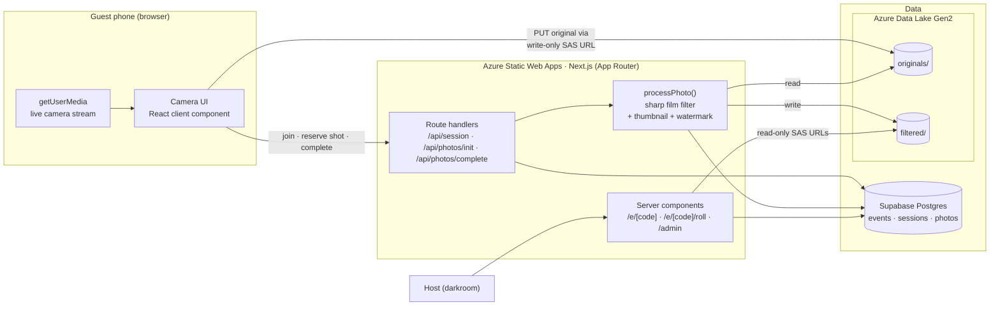
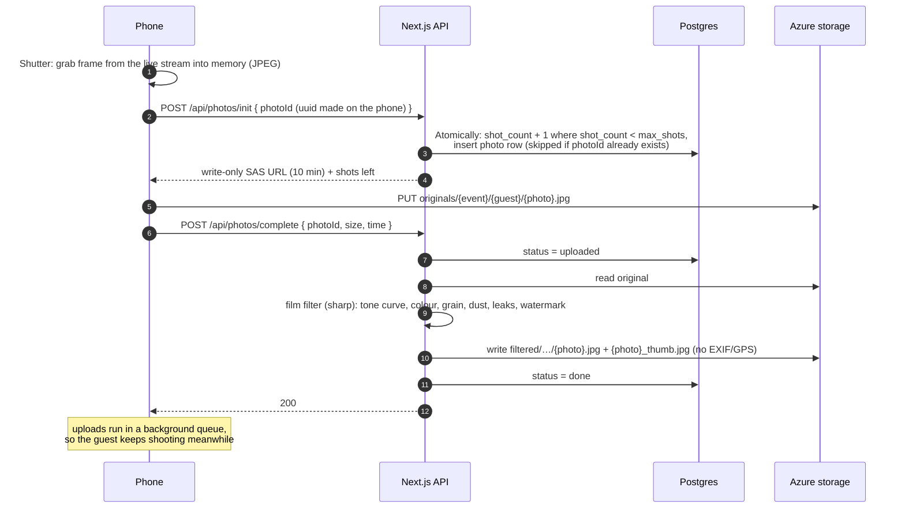

# blindshot

*a disposable camera for your party*

Guests scan a QR code at an event and get a 13-shot roll of film on their phone, with a viewfinder exactly one inch wide. There are no previews: you wind the film, press the shutter, and never see the frame. Every photo is stored untouched, and a copy is developed with a film look tuned against real disposable-camera scans. After the party the whole roll develops at once, and every guest sees everyone's photos.

It started as a tool for one event (a Diwali pop-up in Seattle, November 2026) and is being built so any event can run it with its own theme.

---

## The experience

| Moment | What the guest sees |
|---|---|
| **Scan** | A QR code at the venue opens `/e/{event}` in the phone's browser. No app, no account. |
| **Load film** | First name, email, one consent tick, and two optional opt-outs (no promotional use; keep my photos out of the shared roll). |
| **Shoot** | A camera body on screen: 1-inch live viewfinder, a thumbwheel you drag to wind on, a flash switch, a mechanical shot counter. Shutter → click, flash, vibration, "Saved". Never the photo. |
| **Wrap** | After 13 shots: "That's a wrap", and when the roll develops. |
| **Develop** | At the release time, the shared roll opens: everyone's frames, host picks, your own. |

The host gets a **darkroom** (`/admin`): every frame as it arrives, star and hide, the untouched originals, guests' opt-outs, the QR code to print, and the switch that releases the roll.

---

## Architecture



**The app server never handles image uploads.** Phones upload straight to Azure with a short-lived URL that can write exactly one file and read nothing. The server only issues those URLs, records metadata, and runs the filter.

### Lifecycle of one shot



If the signal drops, the phone keeps retrying the same `photoId`. Because the id is made on the phone, a retry gets a fresh upload URL for the same frame instead of spending another shot.

---

## Stack

| Layer | Choice | Why |
|---|---|---|
| App | **Next.js 16** (App Router, TypeScript) | One codebase for the guest UI, API routes and the darkroom. Built as a self-contained `standalone` server (~60 MB). |
| Hosting | **Azure Static Web Apps** (Free plan, hybrid Next.js) | $0. Server-rendered pages and API routes run on a managed backend; push to `main` deploys, pull requests get preview URLs (the camera needs HTTPS, so previews double as phone test builds). Same Azure account as the photos. |
| Database | **Supabase Postgres** via `postgres.js` | Plain SQL. The shot limit is one atomic statement, so two fast taps can't overrun it. |
| Photo storage | **Azure Data Lake Storage Gen2** | Cheap bulk storage (~10 GB a party); SAS URLs give phones scoped, expiring upload rights. |
| Image processing | **sharp** (libvips) | Fast native processing in Node: about 0.4 s per photo at 2000 px. Every photo is filtered on arrival (≈17 min of compute for a 2,600-photo party) and gets a 640 px thumbnail, so grids load ~60 KB per frame instead of ~700 KB. |
| Camera | **getUserMedia** + canvas | Live 1-inch viewfinder; frames stay in memory, so nothing lands in the camera roll. File-input fallback when access is denied. |
| Styling | Plain CSS with design tokens | Each event theme is a token set; no UI framework to fight. |

---

## Design decisions

**Nothing is stored on the guest's phone.** Shots are taken from the camera stream in memory and uploaded. The trade-off is that a shot still uploading is lost if the page closes, so the page warns before closing.

**The film look is one fixed recipe, not AI.** Early versions used a depth-estimation model to put the flash on whatever was closest to the camera. It looked staged, so it was removed: every photo now goes through the same tone curve, colour grade, grain and defects, tuned against real disposable scans. That also took out a 291 MB dependency that wouldn't fit in a serverless function.

**Originals are sacred.** The file the phone sends is stored byte for byte. The filtered copy is derived from it and carries no EXIF or GPS, and the darkroom always links back to the original.

**No accounts.** Joining sets an httpOnly cookie with a random token, and only its hash is stored. The host logs in with one password; the cookie holds an HMAC of it, never the password itself.

**Consent is explicit and stored per guest.** Every guest agrees to the sharing terms when they join. When an event allows it, guests can also keep their photos off the shared roll or out of promotion, and the darkroom flags those frames.

**Themes are data.** A theme is a CSS token set plus a few decor switches (garland, diya flash light, band text). A new event's look needs no new components.

---

## The film filter

`applyFilmFilter(buffer, options) → buffer` in [`lib/film.ts`](lib/film.ts) is a pure function with tunable options:

1. Decode (HEIC included), fix orientation, resize to a 2000 px scan
2. Tone: S-curve with a lifted, olive-tinted black point and highlights allowed to blow out
3. Colour: richer saturation, slight warmth, olive-green shadows
4. Halation glow around bright lights
5. Clumped grain, stronger in the shadows
6. Plastic-lens vignette, slight softness
7. Defects drawn as SVG layers: dust, curly fibres, the odd scratch, light leaks on about 25% of frames (most likely on the first and last frame, as on a real roll), optional LED date stamp

A local film lab (`npm run lab`) runs it over a folder of photos so the look can be tuned without running the app.

---

## Project lifecycle

| Phase | Status | What it covers |
|---|---|---|
| **0 · Film lab** | ✅ Done | Filter as a pure function, local lab script, tuned against real disposable scans over several rounds. |
| **1 · Interactive mocks** | ✅ Done | Clickable prototype of the guest flow; desi-retro event theme alongside the base look; community roll. |
| **2 · MVP** | ✅ Done | Camera, direct-to-storage uploads, server-enforced roll limit, filtering, shared roll, darkroom, event themes. Tested end to end against local emulators. |
| **3 · Deploy and demo** | ⏳ Next | Supabase + Azure Static Web Apps + Azure storage, real-phone testing, demo to the event partner. |
| **4 · First live event** | 📅 Nov 2026 | ~200 guests, ~2,600 photos. Watch upload success rate, processing time, drop-offs at the camera permission prompt. |
| **5 · Hardening** | Planned | Emailed 4-digit codes to find your roll on any device, upload retry that survives closing the page, rate limiting, queue-based processing for bursts. |
| **6 · Product** | Planned | Host sign-up and self-serve events, theme builder, per-event pricing, bulk download for hosts. |

---

## Repo layout

```
app/
  e/[code]/            guest camera (CameraApp.tsx) and shared roll (roll/)
  admin/               the darkroom: page, server actions, login
  api/session          join an event
  api/photos/init      reserve a frame, issue upload URL
  api/photos/complete  record metadata, filter after response
lib/
  film.ts              the film filter (pure function)
  process.ts           original → filtered pipeline
  storage.ts           Azure SAS URLs, upload, download
  db.ts  session.ts    Postgres, guest + host sessions
  themes.ts            event themes
scripts/               setup, event creation, film lab
supabase/schema.sql    tables
```

---

## Running it

You need **Supabase** (database, free tier) and **Azure** (photo storage + Static Web Apps hosting on the Free plan).

1. **Supabase:** create a project. Copy *Project Settings → Database → Connection string → Transaction pooler* (port 6543).
2. **Azure:** use an existing storage account (ADLS Gen2 is fine) or create one (Standard, LRS). Copy the account name and a key from *Security + networking → Access keys*.
3. **Env:** `cp .env.example .env.local` and fill it in.
4. **Create tables, containers and storage CORS** (safe to re-run; keeps any CORS rules already on the account):
   ```bash
   npm install
   npm run setup
   ```
5. **Create an event:**
   ```bash
   npm run event -- --code diwali --name "Diwali Night" --subtitle "Nov 7 · Seattle" \
     --theme diwali --release 2026-11-09T18:00:00-08:00
   ```
   Leave out `--release` to hold the roll until you release it from `/admin`. Other flags: `--shots 11`, `--no-opt-outs`, `--date-stamp`.
6. **Run it:** `npm run dev`, then open `http://localhost:3000/e/diwali` and `http://localhost:3000/admin`.

### Deploy to Azure Static Web Apps (Free)

Deploys run from [`.github/workflows/deploy.yml`](.github/workflows/deploy.yml): push to `main` → production, pull request → its own preview URL.

1. Create the app (Free plan, no source link; the workflow does the deploying):
   ```bash
   az staticwebapp create -n blindshot -g <resource-group> -l westus2 --sku Free
   ```
2. Give GitHub the deploy token:
   ```bash
   az staticwebapp secrets list -n blindshot --query properties.apiKey -o tsv \
     | gh secret set AZURE_STATIC_WEB_APPS_API_TOKEN
   ```
3. Set the runtime env vars from `.env.example` (`SITE_URL` = your domain):
   ```bash
   az staticwebapp appsettings set -n blindshot --setting-names DATABASE_URL=... AZURE_STORAGE_ACCOUNT=... AZURE_STORAGE_KEY=... ADMIN_PASSWORD=... SITE_URL=https://blindshot.example.com
   ```
4. **Custom domain on Cloudflare:** add a `CNAME` from the subdomain to the app's `*.azurestaticapps.net` hostname, **DNS only (grey cloud)**, then `az staticwebapp hostname set -n blindshot --hostname blindshot.example.com`. Azure validates it and issues the HTTPS certificate. Once that's done you can turn the Cloudflare proxy back on if you want it.
5. Run `npm run setup` locally with the same `SITE_URL`, so storage CORS accepts uploads from the domain.
6. Push to `main`, then open `/admin` and print the QR code.

Hybrid Next.js on Static Web Apps is a Microsoft preview feature. If it misbehaves, the same build runs unchanged on Azure App Service (`node server.js` from `.next/standalone`).

### Testing on a phone

The camera needs HTTPS. The easiest route is a pull request: Static Web Apps gives it its own preview URL. To use your laptop's dev server, open a tunnel (`npx cloudflared tunnel --url http://localhost:3000` or ngrok), add the tunnel URL as `SITE_URL`, and re-run `npm run setup`.

### Film lab

```bash
mkdir -p lab/in && cp ~/some-photos/*.jpg lab/in/   # lab/ is gitignored
npm run lab                                          # writes lab/out/*.jpg
```

Override any option from `DEFAULT_FILM` with `lab/options.json`, e.g. `{ "contrast": 0.85, "grain": { "amount": 0.1 } }`.

---

© 2026 narayave. All rights reserved. The source is public to read; it is not licensed for reuse.
